# Gêmeo digital do braço servo6dof: dataset, modelo digital e infraestrutura

**Atividades do Plano de Trabalho:** Objetivo 3, Atividade 7 (dataset estruturado e documentado);
Objetivo 4, Atividade 11 (modelo digital do braço robótico em ambiente virtual); Objetivo 4,
Atividade 12 (sistema de gêmeo digital, parte de infraestrutura).
**Repositório:** <https://github.com/EduardoCaixeta/cerise-2026-servo6dof-gemeo-digital> (privado)
**Ambiente de execução:** DGX Spark (NVIDIA GB10, arm64, Ubuntu 24.04), containers Docker com ROS 2
Humble e Ignition Gazebo Fortress; data das execuções: 26/10/2026.

## 1. Objetivo

Esta seção registra três entregas encadeadas. A primeira é a consolidação, verificação e documentação
do dataset sintético do braço servo6dof gerado no Gazebo, com imagens RGB, de profundidade e de
segmentação rotuladas com os ângulos das juntas (A7). A segunda é a caracterização do modelo digital do
braço: estrutura física e cinemática extraída do URDF, cinemática direta validada, espaço de trabalho e
planejamento de movimento com MoveIt 2 (A11). A terceira é a infraestrutura do gêmeo digital: um
servidor que transmite quadros de teste do dataset e um visualizador 3D que compara o braço de
referência com o braço reconstruído por um estimador de pose plugável, além do desenho do nó ROS 2
correspondente (A12). A integração do modelo de estimação de pose, desenvolvido por outra frente,
fica para a etapa seguinte, e o ponto de encaixe já está implementado e testado.

## 2. Metodologia e implementação

### 2.1 Base de software e organização

O pacote ROS 2 do braço (`servo6dof_description`, `servo6dof_controller`, `servo6dof_moveit` e
`servo6dof_camera`), fornecido pelo Prof. Dr. Alisson Assis Cardoso e adaptado para o estúdio
fotográfico no Gazebo, foi copiado, sem alterações, para o repositório da frente, junto com os
scripts de geração do dataset e a documentação original. O braço tem cinco juntas de revolução
(`joint_1` a `joint_5`) e uma junta de garra (`joint_6`); as demais juntas da garra são `mimic` de
`joint_6`. Todo o processamento roda em containers com prefixo `cerise26_gemeo`. A imagem
`cerise26_gemeo:latest` deriva da imagem do gerador (`servo6dof:humble`) e acrescenta MoveIt 2 (move_group,
OMPL, KDL), as bibliotecas de análise e FastAPI. A pasta do dataset (`~/braco/dataset`) foi montada
sempre em modo somente leitura, e os metadados derivados foram gravados em `~/cerise2026/gemeo/dataset_meta`.

### 2.2 Dataset (A7)

A geração seguiu um plano fixo e reprodutível (`plano_poses.json`, semente 20260909) com 5.000 poses
sorteadas uniformemente em ±90° para `joint_1` a `joint_5` e em [-40°, 30°] para a garra, descontada
uma folga de 5 % em cada extremo. Para cada pose, o script de captura comanda a trajetória pelo
`FollowJointTrajectory` (3 s de tempo simulado mais 0,5 s de assentamento), descarta os quadros
anteriores e grava um JSON com as juntas comandadas, as juntas reais (lidas de `/joint_states` no
instante da foto) e a garra, além de seis PNGs 1280×720: RGB, profundidade (uint16 em milímetros) e
mapa de rótulos de segmentação das câmeras frontal e diagonal. A renderização usa o ogre2 com EGL da
NVIDIA, e a geração roda com oito instâncias isoladas do Gazebo em paralelo, retomando do disco o que
faltar a cada rodada.

Sobre essa saída, foram implementadas as ferramentas de `dataset_tools/analise/`:

- `indexar.py` gera um índice consolidado (`index.csv`, uma linha por pose) com ângulos, *split*
  recomendado, arquivo, tamanho e data de modificação de cada uma das seis imagens;
- `integridade.py` confere a existência dos arquivos, decodifica integralmente cada PNG e verifica
  dimensões, modo de cor, rótulos de segmentação, profundidade e duplicatas de quadros RGB entre poses;
- `estatisticas.py` calcula contagens, volumes, distribuições angulares frente aos limites, cobertura do
  espaço de juntas e correlações;
- `real_vs_comandado.py` confronta as juntas reais com as comandadas usando a cinemática direta do
  modelo digital;
- `grades.py` gera as grades de amostras e a amostra versionada; `linha_tempo.py` reconstrói a linha do
  tempo e a vazão da geração a partir dos arquivos e dos logs.

O *datasheet* completo está em `docs/DATASET.md`.

### 2.3 Modelo digital (A11)

O URDF foi gerado a partir do xacro dentro do container (`xacro servo6dof.urdf.xacro is_ignition:=true`),
o mesmo que o Gazebo recebe na geração do dataset. A partir dele foram produzidas a tabela de links e
juntas, a árvore cinemática (graphviz) e uma implementação própria de cinemática direta em Python e
numpy (`modelo_digital/cinematica.py`). Essa implementação lê o URDF, compõe as transformações das
origens (convenção RPY de eixos fixos) com as rotações de eixo-ângulo (Rodrigues), resolve as juntas
mimic e oferece uma versão vetorizada para lotes de configurações. A validação comparou essa FK com o TF
publicado pelo `robot_state_publisher` do ROS 2 para o mesmo URDF, em 300 configurações aleatórias e 11
links. O espaço de trabalho foi estimado por Monte Carlo com 100 mil configurações uniformes nos
limites. Também foi implementado um modelo pinhole das câmeras do estúdio (pose do SDF, campo de visão
horizontal de 60°, 1280×720) para projetar as malhas STL posicionadas pela FK sobre as imagens do
dataset e medir o IoU entre a silhueta do modelo e a máscara de segmentação do Gazebo. Por fim, o
MoveIt 2 foi executado sem interface gráfica: `move_group` com OMPL (RRTConnect) e KDL, mais
`ros2_control` com hardware falso (`mock_components/GenericSystem`, gerado por `urdf_fake.py`) e os
controladores originais. Um cliente da ação `/move_action` planejou e executou cinco objetivos.

### 2.4 Infraestrutura do gêmeo digital (A12)

O servidor (`gemeo_digital/servidor/app.py`, FastAPI com uvicorn) roda no container `cerise26_gemeo`,
publicado apenas em `127.0.0.1:8091` do Spark. Ele monta uma sequência de teste com 150 poses do
*split* de teste, ordenadas por vizinho mais próximo no espaço de juntas para que a animação fique
suave, e transmite por WebSocket, quadro a quadro, a imagem da câmera, as juntas de referência, as
juntas previstas, o erro por junta e o erro do efetuador calculado pela FK. A estimação é feita por um
`Predictor` plugável com a interface `predict(rgb, camera) -> {junta: rad}`
(`gemeo_digital/servidor/predictors.py`), que oferece estas implementações:

- `GroundTruthPredictor`: oráculo, devolve a verdade-base;
- `RuidoPredictor`: verdade-base com ruído gaussiano, usado só para demonstrar o painel de erro;
- `PosePredictorAdapter`: carrega `~/cerise2026/pose/inferencia/predict.py` (classe `PosePredictor`)
  quando a frente de pose publicar `~/cerise2026/pose/READY.json`;
- `HttpPredictor`: consulta um serviço de inferência externo.

O front-end, em three.js r160 com urdf-loader 0.13.1 servidos localmente, carrega o URDF e as malhas
STL (resolvendo `package://` para o pacote de descrição) duas vezes: "Braço — referência", em alumínio
sólido, e "Gêmeo digital", verde e translúcido, lado a lado ou sobrepostos. Uma das vistas reproduz a
pose e o campo de visão da câmera do dataset. O painel lateral mostra a imagem, os ângulos por junta e
um gráfico do erro ao longo da sequência. As capturas foram feitas com Playwright (Chromium headless
com WebGL via SwiftShader) no próprio Spark. A verificação de que as malhas aparecem combina o estado JS
da página (robôs e malhas carregados, erros, quadros recebidos), uma análise dos pixels do canvas e a
comparação entre a FK do three.js e a FK do servidor. Para o ecossistema ROS 2 foi desenhado e
implementado o nó `gemeo_twin_node` (imagem → `Predictor` → `/twin/joint_states`), com um segundo
`robot_state_publisher` de prefixo `twin/` e uma configuração de RViz com dois `RobotModel`
(`gemeo_digital/ros2/DESENHO_NO_ROS2.md`).

## 3. Resultados

### 3.1 Dataset (A7)

⟨A7_RESULTADOS⟩

### 3.2 Modelo digital (A11)

**Estrutura física e cinemática.** O URDF gerado tem 13 links e 12 juntas: 11 de revolução, das quais
6 são ativas (`joint_1` a `joint_6`) e 5 são mimic de `joint_6`, e 1 junta fixa (`world`→`base_link`).
O braço tem 5 graus de liberdade e a garra, 1. As malhas STL são aplicadas com fator de escala 6.

| Junta | Pai → filho | Origem xyz (m) | Eixo | Limites (graus) |
|---|---|---|---|---|
| joint_1 | base_link → primeiro_elo | (0; −0,23; −0,01) | z | [−90; 90] |
| joint_2 | primeiro_elo → segundo_elo | (−0,05; −0,03; 0,57) | x | [−90; 90] |
| joint_3 | segundo_elo → terceiro_elo | (0,06; 0; 0,63) | x | [−90; 90] |
| joint_4 | terceiro_elo → quarto_elo | (0; 0,78; 0) | x | [−90; 90] |
| joint_5 | quarto_elo → base_garra | (0,02; 0,36; 0) | y | [−90; 90] |
| joint_6 (garra) | base_garra → garra_elo1 | (−0,072; 0,12; 0,01) | z | [−40; 30] |

As distâncias entre origens consecutivas da cadeia (base_link → base_garra) são 0,23, 0,57, 0,63, 0,78
e 0,36 m. As massas do URDF somam 1,51 kg e todas as inércias são o valor de preenchimento
(Ixx = Iyy = Izz = 1 kg·m²). O modelo é, portanto, cinematicamente completo, mas não dinamicamente
calibrado. As tabelas completas estão em `resultados/modelo_juntas.md` e `resultados/modelo_links.md`.

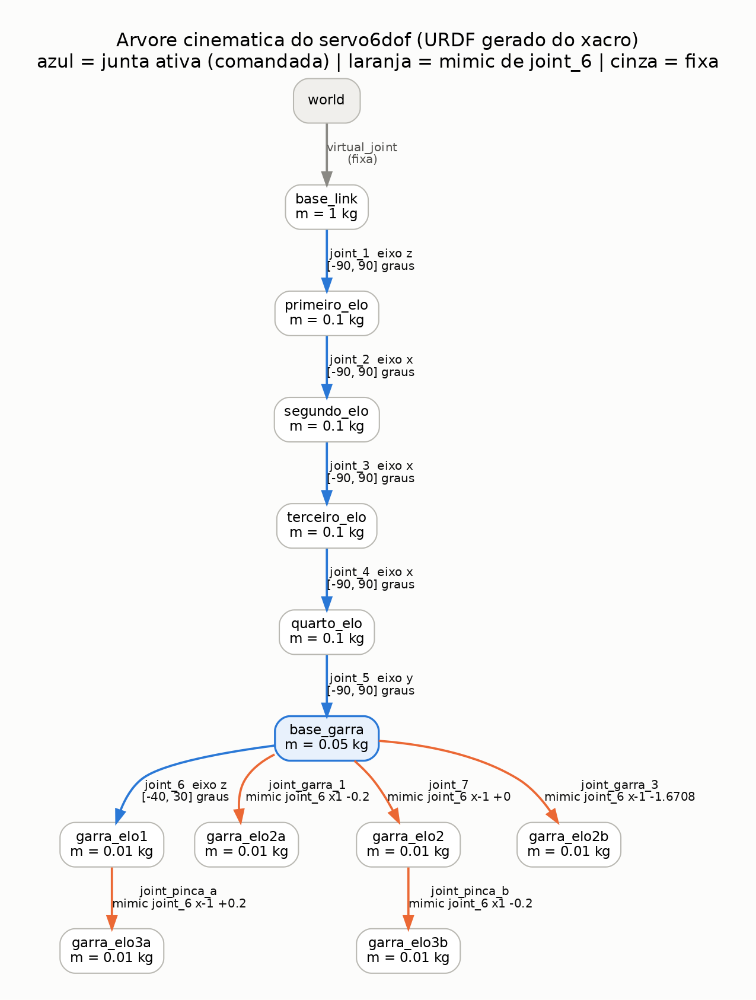

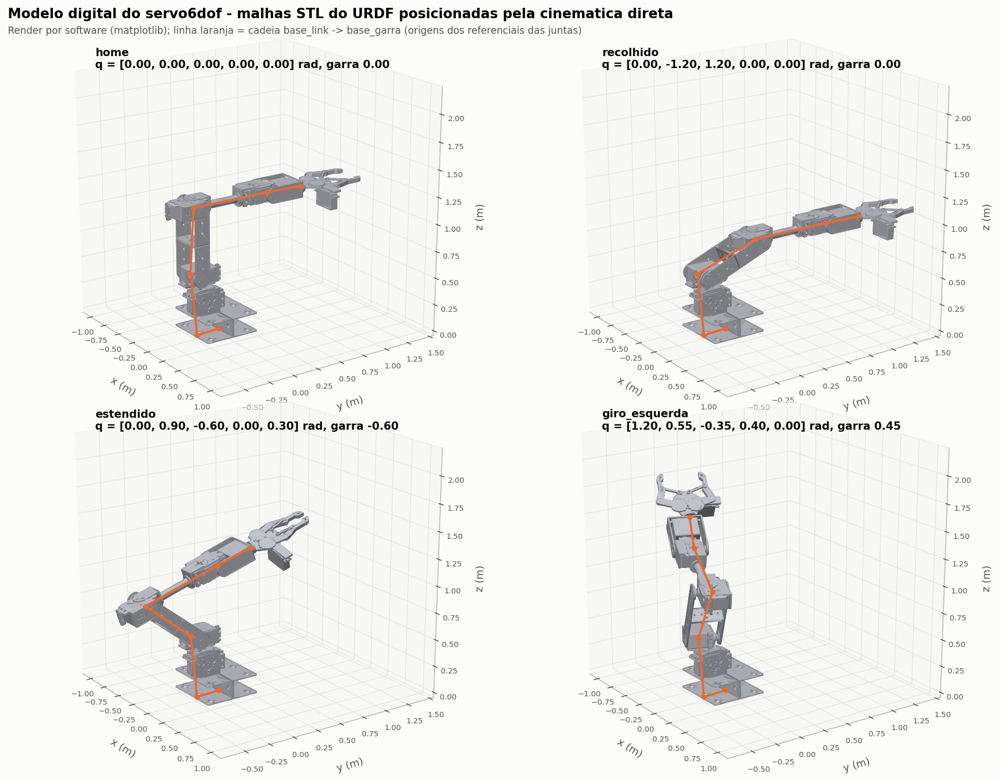

**Validação da cinemática direta.** Nas 3.300 comparações (300 configurações × 11 links), a FK própria
coincidiu com o TF do `robot_state_publisher` com erro máximo de posição de 1,9×10⁻¹⁵ m e de orientação
de 4,2×10⁻⁸ rad, ou seja, no nível do arredondamento numérico, inclusive nos links mimic da garra. A
FK do front-end (three.js/urdf-loader) coincidiu com a do servidor com diferença de até 4,6×10⁻⁷ m, a
precisão de float32.

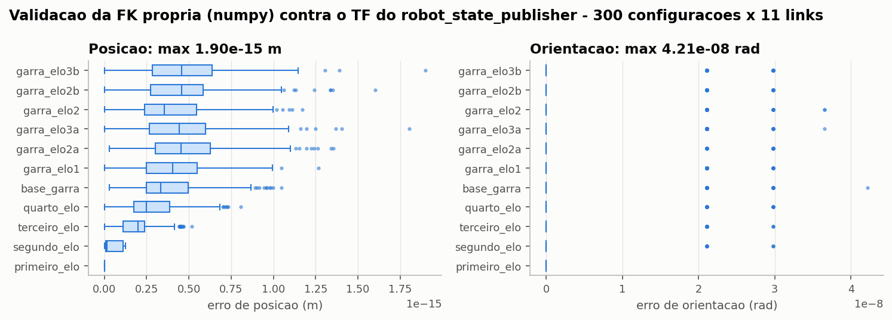

**Espaço de trabalho.** Com 100 mil configurações (FK vetorizada em cerca de 0,4 s), a ponta da garra
alcança até 2,05 m de distância horizontal do eixo de `joint_1`, com z entre −0,82 e 2,58 m. O fecho
convexo tem 27,8 m³ e o volume efetivamente ocupado, medido em voxels de 5 cm, é de 7,9 m³. Cerca de
20 % das configurações dentro dos limites levariam a garra abaixo do plano do chão. Essa propriedade
do modelo explica parte das divergências entre juntas comandadas e reais observadas no dataset.

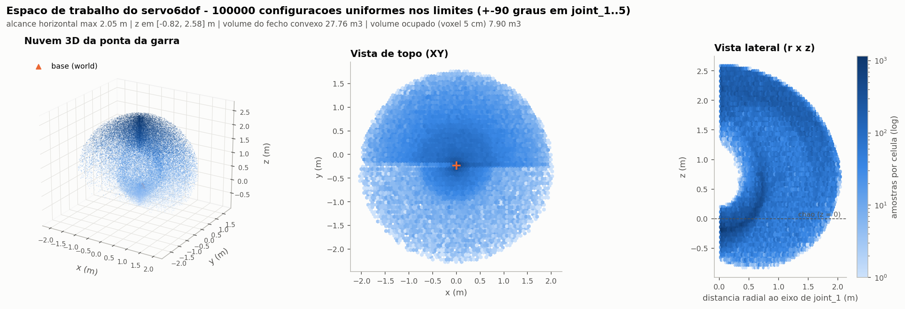

**Modelo × imagens do simulador.** A projeção das malhas, posicionadas pela FK com as juntas registradas
no JSON, sobre as imagens do Gazebo coincide visualmente com o braço renderizado. Isso valida, ao mesmo
tempo, o modelo cinemático, o modelo de câmera e os rótulos do dataset. ⟨IOU_RESULTADOS⟩

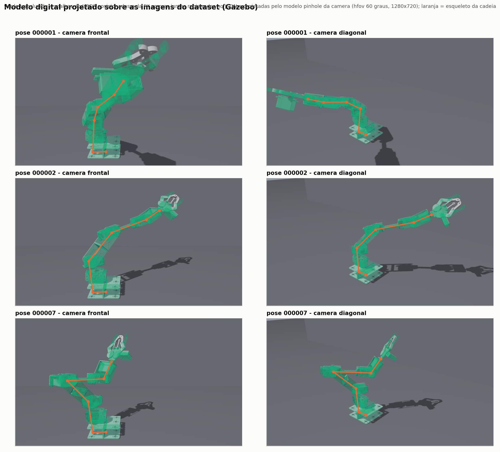

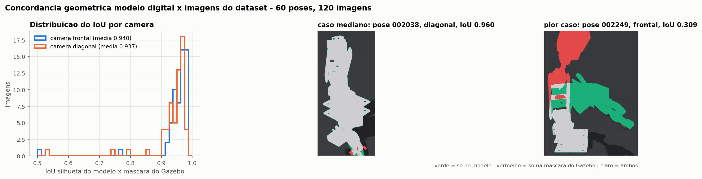

**MoveIt 2 headless.** A configuração do MoveIt 2 do pacote define o grupo `arm` (cadeia base_link →
base_garra) e o grupo `gripper` (`joint_6`), os estados nomeados `home`, `recolhido` e `estendido`
(braço) e `aberta` e `fechada` (garra), o efetuador `garra` e a matriz de colisões desabilitadas. Usa
KDL com IK só de posição (`position_only_ik`, adequada a um braço de 5 GDL) e controladores
`FollowJointTrajectory` para `arm_controller` e `gripper_controller`. Com hardware falso, os cinco
objetivos (três em espaço de juntas, um alvo cartesiano de posição para `base_garra` e o retorno a
`home`) foram planejados e executados com sucesso, e os três controladores ficaram ativos. Em 10
pedidos de planejamento por objetivo:

| Objetivo | Planejamentos com sucesso | Tempo médio (mín.–máx.) | Pontos da trajetória executada | Duração (s) |
|---|---|---|---|---|
| recolhido | 10/10 | 14,5 ms (13,5–15,9) | 23 | 2,18 |
| giro_esquerda | 10/10 | 13,0 ms (3,2–23,7) | 28 | 2,63 |
| estendido | 10/10 | 15,9 ms (13,3–24,6) | 23 | 2,19 |
| alvo_cartesiano | 10/10 | 17,0 ms (12,5–24,3) | 21 | 1,98 |
| home | 10/10 | 12,9 ms (2,1–17,3) | 17 | 1,56 |

No alvo cartesiano, a posição final de `base_garra` (calculada pela FK) ficou a 1,6 cm do alvo, dentro
da região de tolerância esférica de 2 cm especificada no pedido.

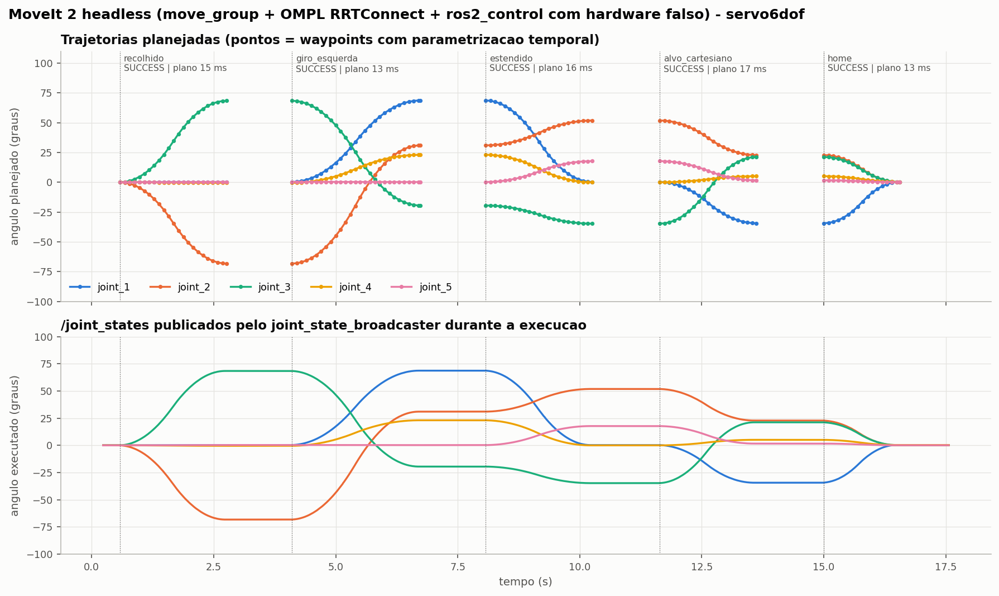

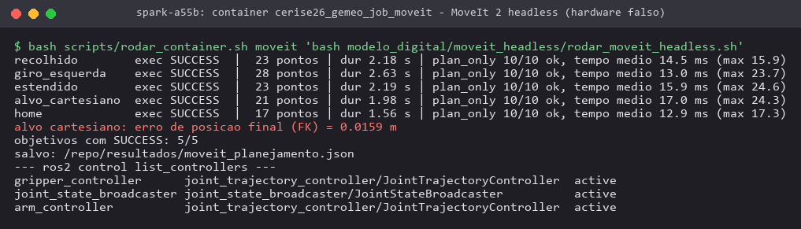

### 3.3 Infraestrutura do gêmeo digital (A12)

O servidor responde em `/saude`, `/api/info`, `/api/quadro/{idx}` e `/ws` e serve o URDF e as malhas do
pacote de descrição. Em todos os cenários capturados, os dois robôs carregaram 12 malhas cada, sem
erros de carregamento, e o WebSocket entregou quadros continuamente (a 2 e 10 quadros/s). O WebGL rodou
em SwiftShader, por software, e a página ficou pronta entre 1 e 2 s em cenário isolado. Com o preditor
oráculo, o erro exibido é nulo, como esperado. Com o preditor de demonstração (ruído gaussiano de 4°
por junta, sem nenhum modelo envolvido), o painel mostra erro médio de alguns graus por quadro e erros
do efetuador da ordem de centímetros a decímetros, o que exercita o gráfico e a tabela. ⟨A12_EXTRA⟩

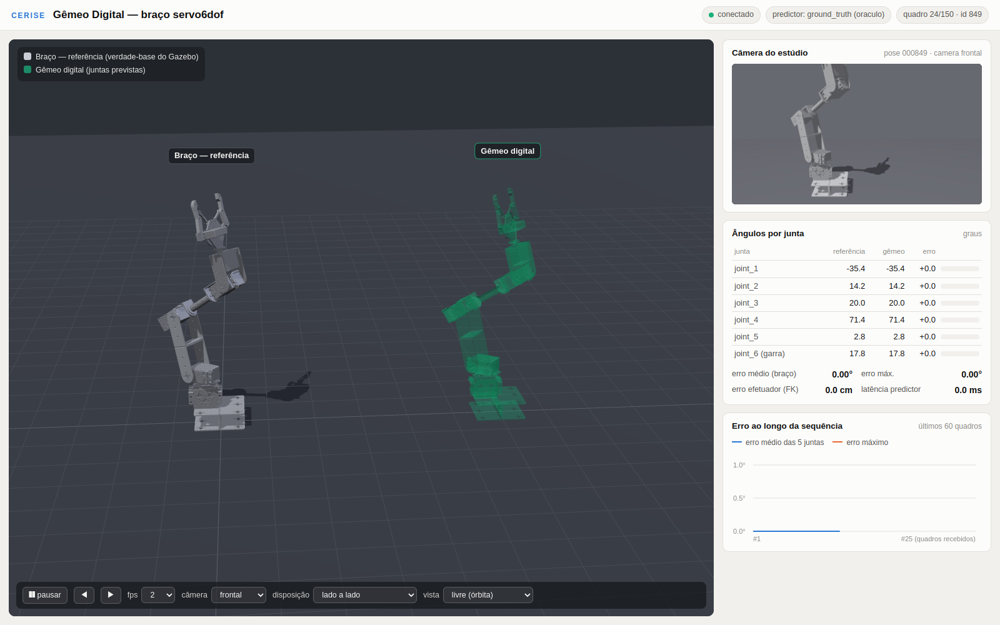

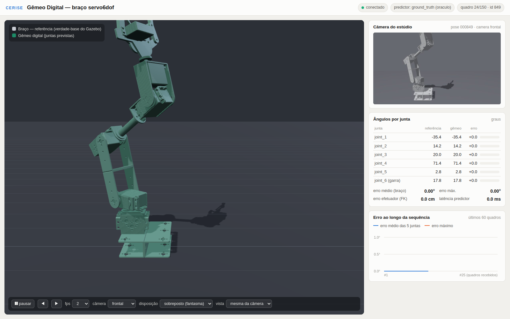

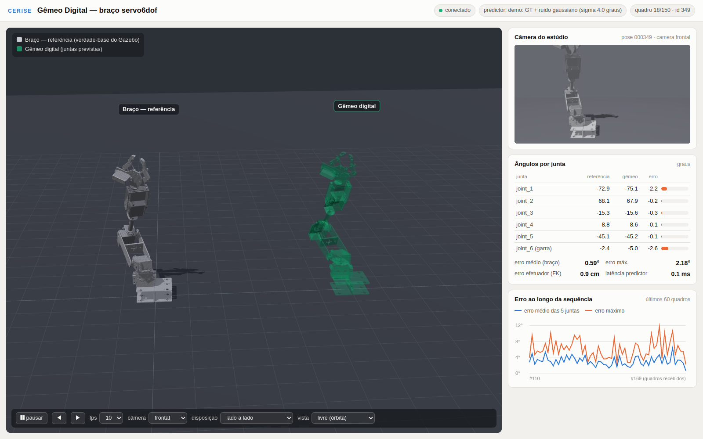

O nó ROS 2 foi testado de ponta a ponta sem Gazebo, reproduzindo poses do *split* de teste. Os tópicos
e nós esperados apareceram, e a pose do efetuador do gêmeo (`twin/base_garra`, descontado o
deslocamento) coincidiu com a da referência no mesmo carimbo de tempo com erro de 4,6×10⁻¹⁶ m. A taxa
observada em `/twin/joint_states` foi de 1,0 a 1,3 Hz para 2 Hz publicados, por perda de quadros de
imagens 1280×720 sem compressão com QoS *best effort* sob carga alta do host.

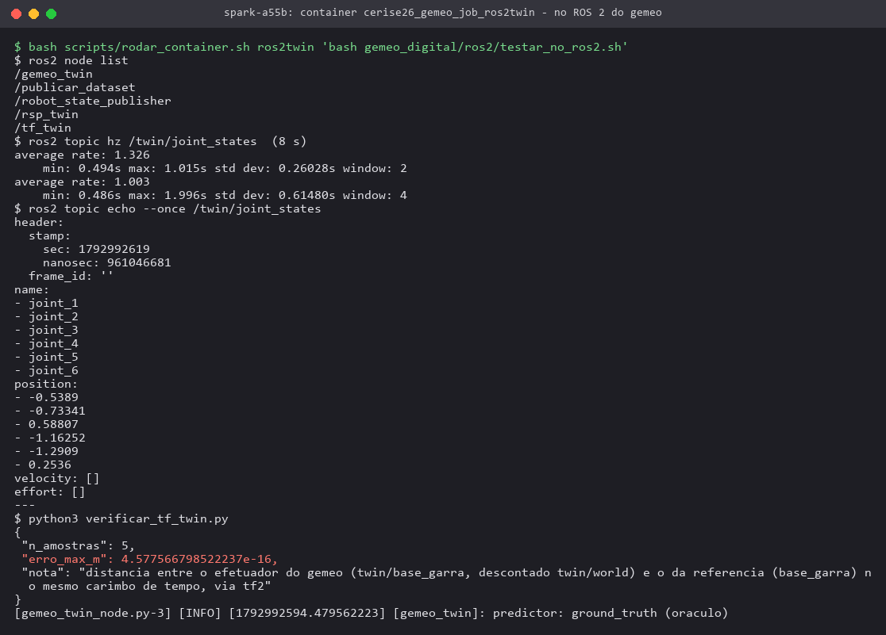

**Como plugar o modelo de pose.** Basta que a frente de pose publique `~/cerise2026/pose/READY.json` e
`~/cerise2026/pose/inferencia/predict.py` com a classe `PosePredictor` cujo método
`predict(rgb, camera)` devolva os ângulos em radianos, e que o servidor seja subido em modo `auto` ou
`pose`. Se o modelo exigir torch e GPU, o servidor deve rodar na imagem da frente de pose
(`IMAGEM=cerise26_pose:latest GPU=1 bash gemeo_digital/subir_servidor.sh pose`). O gráfico de erro e o
erro do efetuador passam então a medir o modelo real.

## 4. Limitações

⟨LIMITACOES_A7⟩
- **Dinâmica não calibrada.** O URDF tem massas simbólicas e inércias de preenchimento (1 kg·m²);
  servem para cinemática e visualização, não para simulação dinâmica fiel.
- **Garra no Gazebo.** O Fortress não implementa `mimic` do URDF; só `joint_6` e `joint_7` são
  acionadas, as pinças têm limites [0, 0] e os elos intermediários ficam passivos. A geometria da garra
  nas imagens, portanto, difere da do modelo mimic. O urdf-loader, por sua vez, satura as pinças em 0
  por causa desses limites. Essa diferença responde por parte do erro de silhueta na região da garra.
- **Segmentação.** O braço sai com rótulo 0, o mesmo de regiões sem objeto (céu sem retorno de
  profundidade na câmera diagonal), porque o plugin `Label` no URDF quebrava os controladores. A máscara
  do braço deve ser obtida como rótulo 0 com profundidade válida, critério adotado aqui.
- **Infraestrutura sem modelo.** As capturas e métricas do gêmeo foram obtidas com o oráculo e com o
  preditor sintético. O desempenho do gêmeo com estimação de pose real depende do modelo da outra
  frente.
- **Acesso.** O servidor está restrito ao loopback do Spark e é acessado por túnel SSH local. A exposição
  pública é decisão pendente do Eduardo e não foi feita.

## 5. Próximos passos

1. Integrar o `PosePredictor` assim que a frente de pose publicar `READY.json`, medir o erro por junta e
   do efetuador na sequência de teste e repetir as capturas.
2. Regerar ou filtrar as poses do plano que atravessam o chão, ou incluir o chão como objeto de colisão
   no planejamento, para que juntas comandadas e reais coincidam; manter as juntas reais como rótulo.
3. Corrigir o rótulo de segmentação do braço (por exemplo, `Label` no SDF gerado em vez do URDF) e
   calibrar massas e inércias a partir do CAD ou de medições do braço físico.
4. Conectar o nó ROS 2 do gêmeo ao Gazebo ao vivo (e depois ao braço real), com `image_transport`
   comprimido, e gravar sessões em rosbag para avaliação.
5. Se for decidido expor o visualizador, adotar proxy com autenticação na rede do laboratório em vez de
   abrir portas do Spark.
