# Atividade 12 — Gêmeo digital integrado ao modelo de detecção de pose

**Objetivo 4, Atividade 12** do Plano de Trabalho CERISE/EMC/UFG 2026: integrar o modelo de detecção
de pose ao ambiente virtual do braço robótico servo6dof. **Resultado esperado:** um gêmeo digital capaz de
reproduzir o comportamento do braço a partir dos dados capturados.

Repositório: `cerise-2026-servo6dof-gemeo-digital` (organização CERISE no GitHub, branch `main`). O
código da integração está em `gemeo_digital/servidor`, `gemeo_digital/integracao` e `gemeo_digital/ros2`. A
criação do repositório remoto e o *push* dependeram de autorização do Eduardo, concedida em 26/10/2026; até
então, o código ficou commitado apenas no espelho local.
Modelo de pose: repositório `cerise-2026-pose-servo6dof`, da mesma organização (Atividades 8 e 9).
Medições: `resultados/a12_integracao/`. Execução em 26/10/2026, das 06h40 às 07h30 (horário de Brasília),
no DGX Spark (NVIDIA GB10, arm64).

## 1. Objetivo e escopo

Esta etapa liga as duas partes desenvolvidas antes:

- o **modelo de estimação de pose** (HPE + Depth Anything V2, herdado de 2025 e retreinado no dataset
  sintético do servo6dof), que recebe uma única imagem RGB 1280×720 de uma das câmeras fixas do estúdio
  e devolve os ângulos `joint_1`…`joint_5`;
- a **infraestrutura do gêmeo digital** (servidor FastAPI/WebSocket, front-end three.js com o URDF e as
  malhas STL do braço, nó ROS 2), construída com um `Predictor` plugável.

No gêmeo, o braço **"referência"** segue a verdade-base do Gazebo (`juntas_reais`). O braço **"gêmeo
digital"** segue apenas as juntas que o modelo prevê **a partir da imagem**: o modelo não recebe nenhuma
anotação. A comparação quadro a quadro entre os dois mede quão bem o gêmeo reproduz o braço.

## 2. Metodologia

### 2.1 Arquitetura da integração

| Camada | Componente | Função |
|---|---|---|
| Captura | imagens do dataset (`~/braco/dataset`, câmeras `frontal` e `diagonal`) ou tópico ROS 2 `/camera_*/image` | fonte das imagens (no futuro, a câmera do braço físico) |
| Inferência | `PosePredictorAdapter` (`servidor/predictors.py`) carregando `~/cerise2026/pose/inferencia/predict.py` conforme o contrato `READY.json` | recorte fixo da câmera → Depth Anything V2 (vitl) → HPE → juntas (rad) e 7 keypoints 2D/3D |
| Servidor | `servidor/app.py` (FastAPI + WebSocket), no contêiner `cerise26_gemeo` com a imagem `cerise26_pose:latest` (torch + GPU), publicado só em `127.0.0.1:8091` | lê a imagem, chama o modelo, calcula o erro e a cinemática direta e envia o quadro (JPEG da câmera, juntas GT e previstas, keypoints, tempos) |
| Visualização | `servidor/static/` (three.js r160 + urdf-loader 0.13.1) | dois braços do mesmo URDF (referência sólida e gêmeo verde translúcido), lado a lado ou sobrepostos na vista da câmera, com o esqueleto 2D previsto sobre a imagem, a tabela de juntas e o gráfico de erro |
| ROS 2 | `ros2/gemeo_twin_node.py` com `predictor=http` → `POST /api/prever` | imagem → `/twin/joint_states` → `robot_state_publisher` com prefixo `twin/` → TF → RViz |

Alterações feitas nesta etapa:

1. **Mesmo conjunto de teste do modelo.** O servidor passou a montar a sequência a partir do split da
   frente de pose (80/10/10 por pose, semente 2026, lido de `dados/final/index.npz`), e não mais do
   `id % 10` do datasheet. Assim nenhuma imagem de treino do modelo entra na avaliação: são 500 poses ×
   2 câmeras = 1.000 imagens, ordenadas por vizinho mais próximo no espaço de juntas para a animação
   ficar contínua.
2. **Protocolo de medição.** O WebSocket recebe o estado inicial na URL (`?camera=&fps=&idx=`) e aceita
   `fps=0` (**malha fechada**: o próximo quadro só é enviado quando o front-end confirma que desenhou o
   anterior). Depois de aplicar as juntas, o front-end espera o quadro de animação seguinte, força o fim
   do desenho (`gl.readPixels`) e devolve um `ack` com o instante em que o gêmeo atualizado já está nos
   pixels do canvas. O servidor grava, por quadro e em JSONL, as juntas, os erros e os tempos de cada
   etapa (`GEMEO_LOG_DIR`).
3. **Novas rotas.** `POST /api/prever` expõe o modelo a outros clientes, como o nó ROS 2; `GET
   /api/recursos` informa a memória de GPU do torch, o RSS e o cgroup.
4. **Front-end.** O esqueleto 2D previsto pelo modelo passou a ser desenhado sobre a imagem da câmera.
   Foram adicionados os indicadores "ponta a ponta" e "quadros/s" e a taxa "máx.". A garra (`joint_6`),
   que o modelo não estima, aparece como "n/e".
5. **ROS 2.** O QoS das imagens passou a ser configurável. Com o perfil `sensor` (BEST_EFFORT), só 3
   imagens de 1280×720 (2,7 MB cada) chegaram em 40 s, por perda de fragmentos no DDS; com
   `confiavel` (RELIABLE, fila 1) chegaram todas. Como o modelo não estima a garra, o nó publica
   `joint_6` com um valor fixo (0 rad) apenas para completar a árvore TF do gêmeo no RViz.

### 2.2 Métricas

- **Erro por junta:** |θ̂ − θ| em graus, com média, mediana, p95 e máximo sobre os 1.000 quadros, por
  câmera e no total. Como a junta 5 (rotação da garra) não é observável pelos 7 keypoints do modelo
  (limitação já registrada pela frente de pose), o erro médio é informado também só para as juntas 1–4.
- **Erro do efetuador:** distância entre as origens do link `base_garra` obtidas pela cinemática direta
  do URDF com as juntas previstas e com as juntas verdadeiras (base do robô fixa e conhecida). É uma
  medida da fidelidade espacial do gêmeo e não equivale ao "erro 3D" da frente de pose, que é calculado
  nos keypoints e no referencial da câmera.
- **Latência ponta a ponta:** do início da leitura da imagem no servidor até o `ack` de "gêmeo desenhado"
  no navegador. O navegador e o servidor rodam no mesmo host, então o relógio é comum. O tempo também é
  dividido por etapa: leitura do PNG, modelo, FK + JPEG, serialização + WebSocket e atualização no
  three.js.
- **FPS sustentado:** quadros desenhados por segundo, medidos pelos instantes de `ack`, em malha fechada
  e com taxas-alvo fixas (2, 5 e 10 quadros/s).
- **Navegador:** Chromium headless (Playwright) no Spark. WebGL na GPU do GB10 via ANGLE/EGL; o
  navegador continua headless e não usa a tela física do Spark. Para comparação, uma sessão curta usou
  SwiftShader (rasterização na CPU).

## 3. Resultados

### 3.1 Fidelidade do gêmeo (conjunto de teste, apenas imagem)

**Tabela 1 — Erro absoluto por junta no gêmeo (graus): média / mediana / p95 / máximo.**

| Junta | Câmera frontal (500) | Câmera diagonal (500) | Total (1.000) |
|---|---|---|---|
| joint_1 (base) | 4,08 / 2,88 / 11,5 / 32,0 | 4,30 / 2,97 / 12,3 / 43,5 | **4,19** / 2,92 / 11,9 / 43,5 |
| joint_2 (ombro) | 3,12 / 1,81 / 9,1 / 111,3 | 2,96 / 2,00 / 8,7 / 40,4 | **3,04** / 1,89 / 9,0 / 111,3 |
| joint_3 (cotovelo) | 4,09 / 2,51 / 12,1 / 117,8 | 3,73 / 2,54 / 10,8 / 34,4 | **3,91** / 2,54 / 11,6 / 117,8 |
| joint_4 (punho) | 10,46 / 6,41 / 37,6 / 84,7 | 10,57 / 6,79 / 33,9 / 91,8 | **10,52** / 6,63 / 36,1 / 91,8 |
| joint_5 (rotação da garra) | 41,75 / 42,71 / 78,0 / 83,3 | 41,71 / 42,47 / 78,0 / 83,2 | **41,73** / 42,49 / 78,0 / 83,3 |
| média juntas 1–4 | 5,44 | 5,39 | **5,41** (mediana 3,83; p95 15,4) |
| média das 5 juntas | 12,70 | 12,66 | **12,68** |

O erro do gêmeo coincide com a avaliação offline da frente de pose nas mesmas 1.000 imagens: 12,68° de
média e 4,19 / 3,04 / 3,91 / 10,52 / 41,73° por junta (`READY.json`). Isso confirma que a integração
(leitura do PNG 1280×720, recorte, DA-V2 e HPE a cada quadro, adaptador e conversão de unidades) não
introduz erro. O viés médio é pequeno em todas as juntas (|viés| ≤ 1° nas juntas 1–4).

**Tabela 2 — Erro do efetuador (`base_garra`, FK) no gêmeo.**

| | Frontal | Diagonal | Total |
|---|---|---|---|
| mediana / média (mm) | 78,0 / 109,9 | 74,2 / 104,3 | **76,4 / 107,1** |
| p95 / máximo (mm) | 275,0 / 991,4 | 262,0 / 910,3 | 275,0 / 991,4 |
| quadros < 50 mm / < 100 mm | 26,0 % / 61,2 % | 28,4 % / 67,8 % | 27,2 % / 64,5 % |

O braço tem alcance horizontal de 2,05 m, o que amplifica os erros angulares no efetuador: 1° no ombro
desloca a garra em cerca de 36 mm.

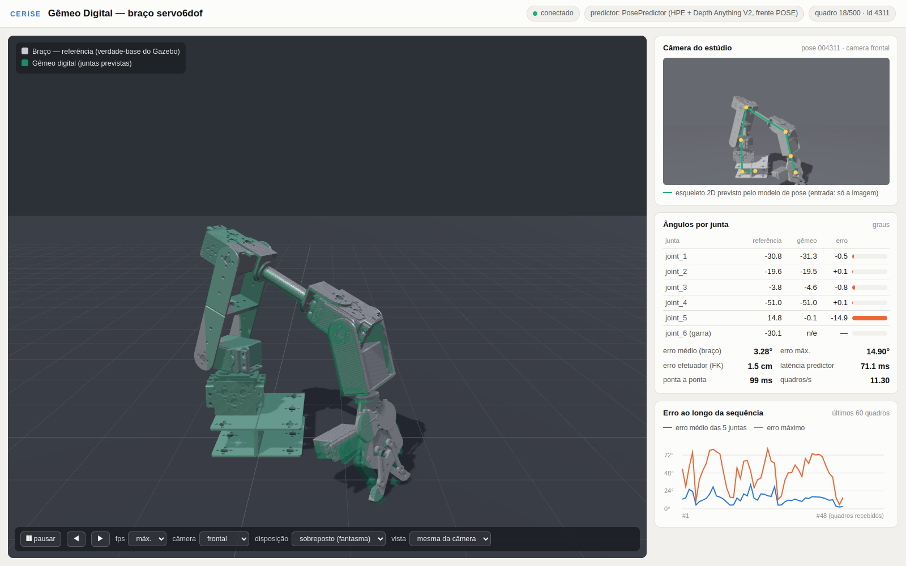

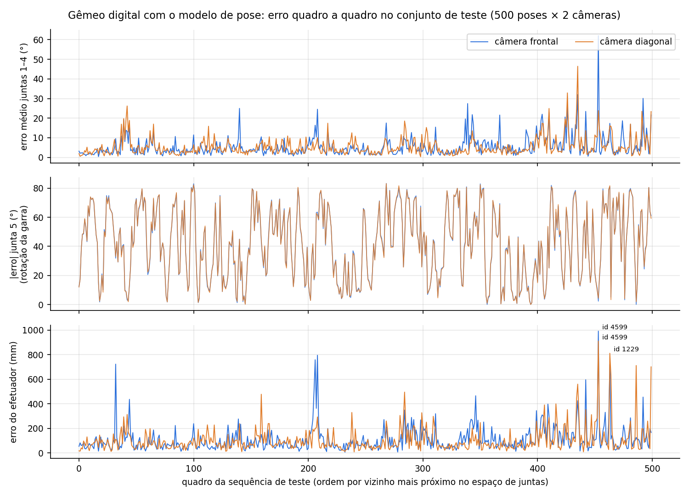

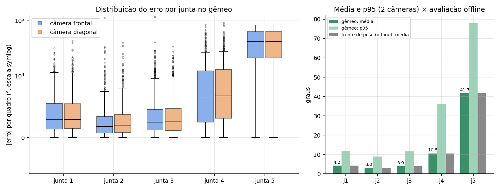

### 3.2 Latência e taxa de quadros

**Tabela 3 — Tempo por etapa (1.000 quadros, malha fechada, WebGL na GPU), em ms.**

| Etapa | Mediana | Média | p95 |
|---|---|---|---|
| Leitura do PNG 1280×720 | 8,4 | 10,1 | 18,2 |
| Modelo de pose (recorte + DA-V2 + HPE, com sincronização da GPU) | 77,7 | 103,1 | 180,4 |
| FK + JPEG da câmera para o painel | 3,6 | 4,4 | 8,6 |
| Serialização + WebSocket (loopback) | 1,3 | 1,4 | 2,2 |
| Atualização no three.js até os pixels do canvas | 14,1 | 15,0 | 18,2 |
| **Ponta a ponta (imagem → predição → gêmeo desenhado)** | **99,6** | 134,5 | 216,9 |

**Tabela 4 — Taxa sustentada.**

| Sessão | Quadros | FPS medido | Ponta a ponta (mediana) |
|---|---|---|---|
| frontal, malha fechada (máx.) | 501 | **9,76** | 99,2 ms |
| diagonal, malha fechada (máx.) | 502 | 5,93 | 183,3 ms |
| frontal, alvo 2 quadros/s | 60 | 2,00 | 88,6 ms |
| frontal, alvo 5 quadros/s | 60 | 5,00 (desvio do intervalo 0,5 ms) | 89,2 ms |
| frontal, alvo 10 quadros/s | 60 | 9,97 | 87,6 ms |
| frontal, malha fechada, navegador com SwiftShader (CPU) | 40 | 0,42 | 2.842 ms |

A diferença entre as sessões frontal e diagonal vem da carga da GPU no momento, e não da câmera. Num
controle feito em seguida, com 120 chamadas alternando as câmeras quadro a quadro, a latência do modelo
foi de 65,2 ms (frontal) e 64,6 ms (diagonal)
(`resultados/a12_integracao/controle_latencia_cameras_alternadas.json`). A GPU do Spark é compartilhada
com os serviços de produção (vLLM) e com outras frentes, o que explica a distribuição bimodal da
latência (modos perto de 100 ms e de 200 ms). A memória de GPU do modelo teve pico de 2,94 GB alocados e
3,18 GB reservados pelo torch, abaixo do teto de 4 GB reservado para esta atividade. O contêiner usou 3,1–5,2 GB de RAM
(cgroup). Com rasterização por software (SwiftShader), o desenho de cada quadro a 1600×1000 leva cerca
de 1,9 s: o gêmeo precisa de um navegador com WebGL acelerado.

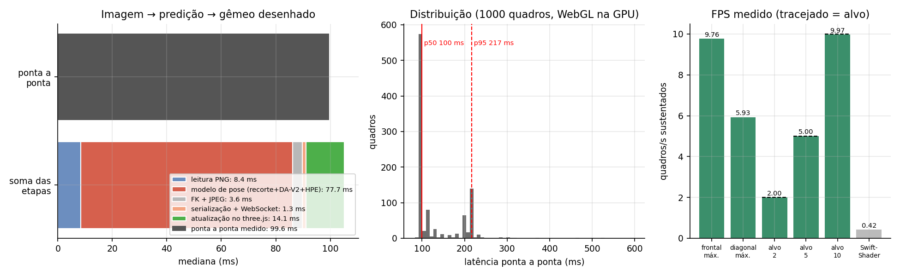

### 3.3 Casos de falha

**Tabela 5 — Piores quadros pelo erro do efetuador, com diagnóstico automático
(`resultados/a12_integracao/piores_quadros.json`).**

| Pose (câmera) | Efetuador | Juntas 1–4 | Diagnóstico |
|---|---|---|---|
| 4599 (frontal) | 991 mm | 62,1° | **Ambiguidade de configuração:** j2 +111° e j3 −118°. O modelo escolheu a solução de "cotovelo invertido", cuja silhueta 2D é parecida. O braço está próximo da câmera (1,44 m) e todos os keypoints 2D erram 125–213 px |
| 4599 (diagonal) | 910 mm | 23,8° | Mesma pose: erro concentrado no punho (j4 −40°), com 7 % do braço fora do recorte fixo da câmera |
| 1229 (diagonal/frontal) | 811 / 720 mm | 16–17° | Braço cortado pelo enquadramento (keypoints na borda da imagem), garra a 0,13 m do chão (oclusão e sombra) e contato com o piso; a ponta da garra erra até 625 px |
| 3091 (frontal) | 795 mm | 24,5° | Braço cortado pela borda superior da imagem; punho (j4 +33°) |
| 513 (frontal) | 759 mm | 16,4° | Braço cortado pelo enquadramento; ombro (j2 −26°) |
| 22 (frontal) | 723 mm | 9,5° | Braço cortado pelo enquadramento; pose em contato com o piso (reais × comandadas diferem 13°) |

Fatores medidos numa amostra de 200 quadros (1 em cada 5 da sequência):

- **Braço cortado pelo enquadramento** (keypoints verdadeiros na borda ou fora da imagem): 22,5 % dos
  quadros, erro mediano do efetuador de 117 mm contra 70 mm nos demais. Está presente em 45 % dos 20
  piores quadros. É o principal modo de falha.
- **Braço parcialmente fora do recorte fixo** (> 3 % dos pixels): 7 % dos quadros, 118 mm contra 78 mm.
- **Giro da base:** o erro cresce com |joint_1| (Spearman 0,36), ou seja, com o braço apontando de
  lado para as câmeras, quando há escorço e ambiguidade de profundidade.
- **Contato com o piso e garra rente ao chão** não pioram o erro mediano (67 contra 88 mm e 55 contra
  83 mm), mas aparecem em 35 % e 25 % dos 20 piores quadros.
- **Junta 5:** domina o erro médio das 5 juntas (41,7°) sem afetar a posição do efetuador. É a limitação
  dos 7 keypoints do modelo, que não veem a rotação da garra.

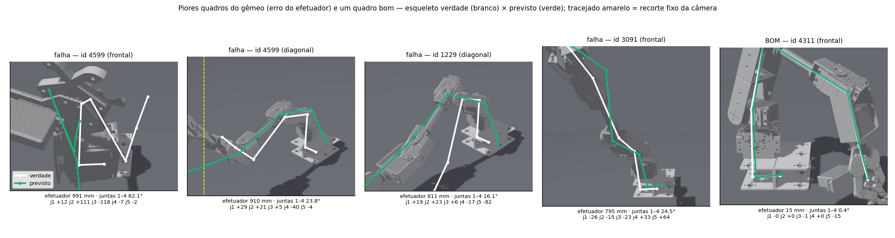

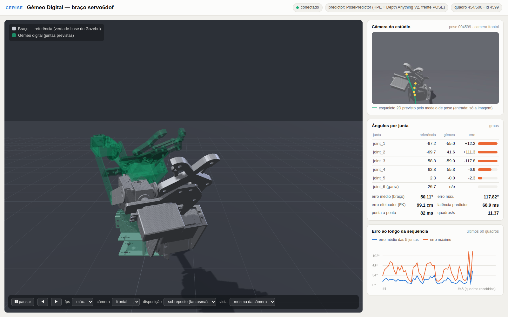

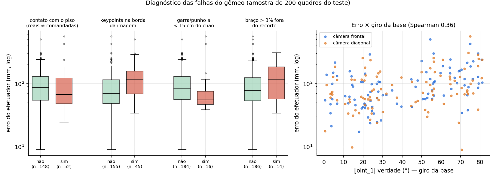

### 3.4 Varredura de poses (animação)

As animações mostram 72 quadros consecutivos da sequência de teste, a 4 quadros/s:
`evidencias/a12i_varredura_gemeo_lado.mp4` (e `.gif`), com os braços lado a lado, e
`evidencias/a12i_varredura_gemeo_sobreposto_diagonal.mp4` (e `.gif`), com o gêmeo sobreposto na vista
da câmera diagonal.

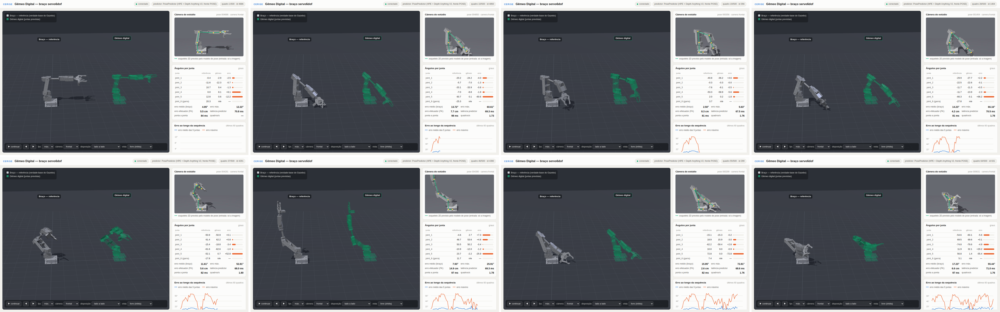

### 3.5 Gêmeo em ROS 2 com RViz (headless)

O nó `gemeo_twin` recebeu as imagens da câmera frontal do conjunto de teste, publicadas pelo
`publicar_dataset.py` a 2 Hz junto com a verdade-base em `/joint_states`. A cada imagem, o nó chamou o
modelo pelo `POST /api/prever` e publicou `/twin/joint_states` com o carimbo da imagem. Um
`robot_state_publisher` com prefixo `twin/` gerou o TF, e o RViz 2 rodou em Xvfb (tela virtual) com os
dois `RobotModel`. Resultado (`resultados/a12_integracao/ros2_twin_pose.json`, 40 s):

| Indicador | Valor |
|---|---|
| `/twin/joint_states` | 80 mensagens a 2,00 Hz; 79 pares casados com a referência pelo carimbo |
| atraso imagem → `/twin/joint_states` | mediana 255 ms, p95 282 ms (o modelo via HTTP, incluindo a codificação PNG, leva 87 ms; o restante é o transporte DDS da imagem bruta de 2,7 MB em modo confiável) |
| erro médio por junta | 4,2 / 5,3 / 4,6 / 11,0 / 37,6° (60 poses de teste em ciclo; compatível com a Tabela 1) |
| erro do efetuador | mediana 77 mm |

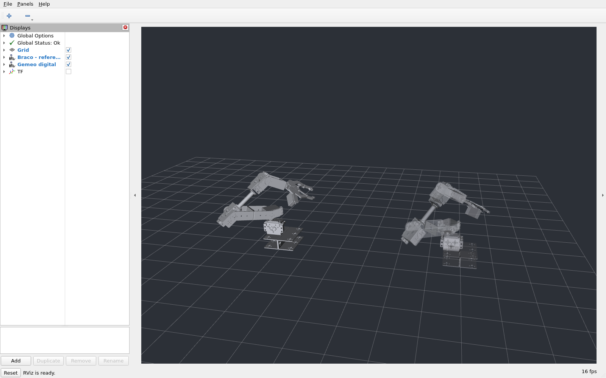

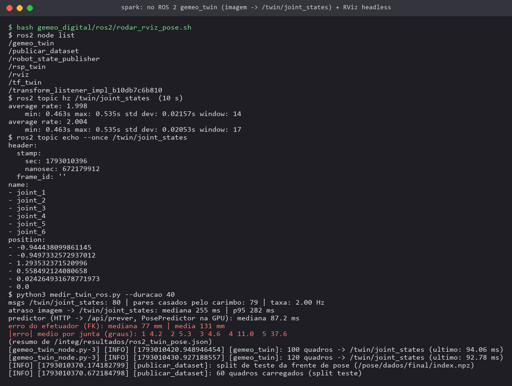

### 3.6 Prints de execução

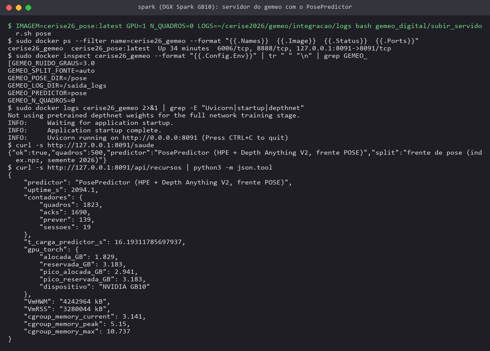

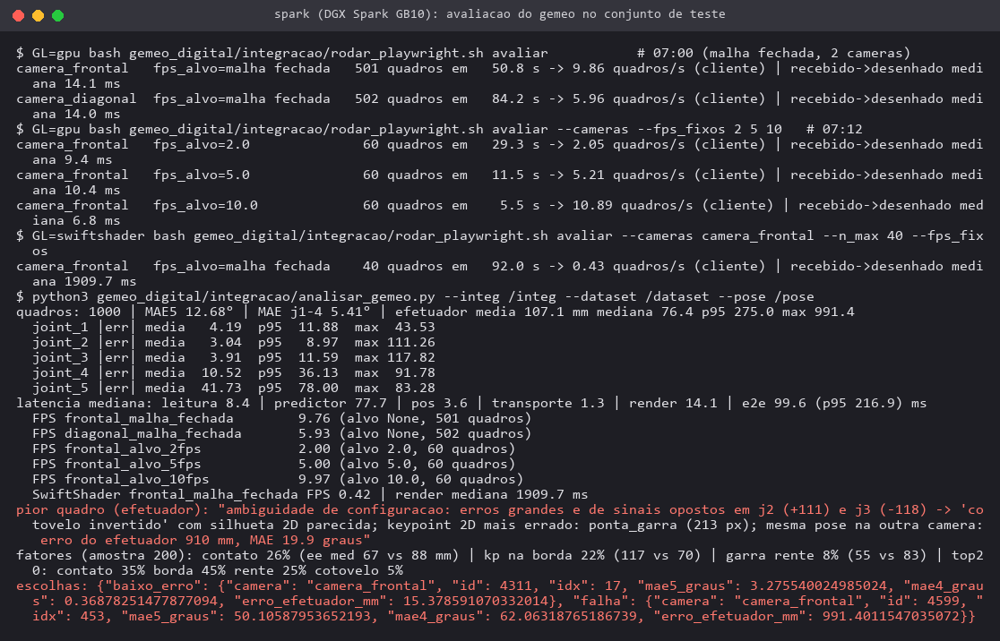

## 4. Discussão

O gêmeo reproduz o comportamento do braço nas juntas que o modelo observa bem. Nas juntas 1–4, o erro
mediano é de 3,8° e 64,5 % dos quadros ficam com o efetuador a menos de 10 cm da posição real, a cerca
de 10 quadros/s e com latência mediana de 0,1 s, o que é adequado para acompanhamento visual. O valor
final depende essencialmente do modelo de pose: a integração não acrescenta erro (Tabela 1 = avaliação
offline) e acrescenta pouco tempo (cerca de 22 ms além do modelo, com WebGL na GPU). Os maiores
problemas são a rotação da garra (j5), que não é observável, e as poses em que o braço sai do
enquadramento das câmeras fixas. Nesses casos aparecem erros grandes e até ambiguidades de configuração
(cotovelo invertido), que um gêmeo com uma única câmera não consegue resolver sem informação temporal ou
uma segunda vista.

## 5. Limitações

- **Validação feita apenas em simulação:** imagens sintéticas do Gazebo, com as mesmas duas câmeras fixas
  do treino. Ainda não há imagens do braço físico, e a frente de pose mostrou que o modelo não generaliza
  para outra câmera (140 mm na frontal contra 419 mm na diagonal quando treinado só com a frontal).
- A junta 5 não é estimada de forma útil (41,7°) e a garra (`joint_6`) não é estimada. No gêmeo, a garra
  aparece como "n/e" e, no ROS 2, é fixada em 0 rad só para completar a árvore TF.
- A latência foi medida com a GPU compartilhada com a produção. Os números variam com a carga (modos de
  ~100 e ~200 ms) e não há garantia de tempo real.
- O navegador das medições roda no mesmo host do servidor (WebSocket em loopback). Um cliente remoto
  soma a latência da rede, e um navegador sem WebGL acelerado fica inviável (0,42 quadro/s com
  SwiftShader).
- Cada quadro é tratado de forma independente, sem filtro temporal; a sequência de teste é uma ordenação
  de poses independentes, não um movimento contínuo real.
- No ROS 2, imagens brutas de 2,7 MB exigem QoS confiável e dominam o atraso (255 ms); o perfil
  `sensor` perde quase todas.

## 6. Próximos passos

1. **Braço físico:** calibrar uma câmera real na mesma pose das câmeras do estúdio (ou retreinar com a
   pose real), coletar imagens com os ângulos dos servos como verdade e repetir esta avaliação. O
   servidor já aceita outra fonte de imagens (`HttpPredictor`/nó ROS 2) sem mudança no front-end.
2. Usar as duas câmeras ao mesmo tempo, com fusão das predições, e um filtro temporal (Kalman ou média
   móvel com restrição de velocidade) para reduzir as ambiguidades de configuração e o ruído do punho.
3. Adicionar keypoints nas pinças da garra para observar j5 e j6 (pendência da frente de pose).
4. Desempenho: Depth Anything V2 Small/Base ou TensorRT para o modelo, `image_transport` comprimido no
   ROS 2 e pipelining no servidor (calcular o quadro k+1 enquanto o k é desenhado).
5. Decisão, ainda pendente, sobre expor o visualizador. Hoje ele é acessível só por túnel SSH local
   (`ssh -N -L 127.0.0.1:18091:localhost:8091 spark-bridge` → <http://127.0.0.1:18091>).

## 7. Reprodutibilidade

Os comandos estão no `README.md`, seção "Integração com o modelo de pose e avaliação (A12)". Arquivos de
medição em `resultados/a12_integracao/`:

- `metricas_gemeo_integracao.json`: todas as métricas agregadas;
- `quadros_gemeo_teste.csv`: os 1.000 quadros;
- `piores_quadros.json/.csv`;
- `cliente_avaliacao_*.json`;
- `controle_latencia_cameras_alternadas.json`;
- `ros2_twin_pose.json`;
- `recursos_servidor_pos_avaliacao.json`;
- `logs_sessoes_websocket.tar.gz`: JSONL brutos de cada sessão.

As sessões da primeira tentativa com taxa fixa foram descartadas por um erro no driver: `?fps=2.0` não
casava com as opções do seletor, e as sessões rodaram em malha fechada. Elas foram refeitas depois da
correção e não entram em nenhum número desta seção.
