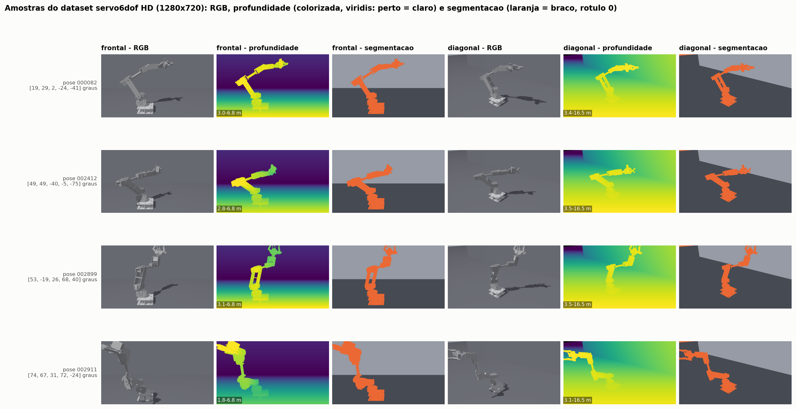
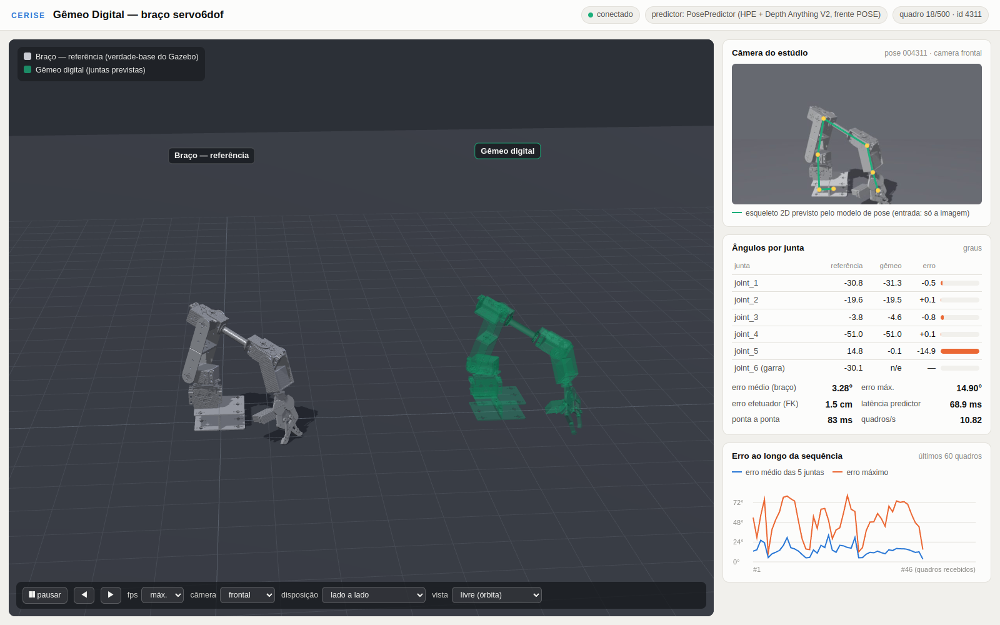

# Dataset sintético, modelo digital e gêmeo digital do braço robótico

## O que será reproduzido

Este roteiro reproduz o trabalho com o braço robótico virtual servo6dof: a geração de um dataset sintético multimodal no Ignition Gazebo Fortress, o modelo digital do braço (URDF, cinemática direta validada e planejamento com MoveIt 2) e o gêmeo digital, que mostra no navegador ou no RViz um segundo braço acompanhando as juntas estimadas a partir da imagem. Tudo roda em contêineres Docker com ROS 2 Humble, a partir do repositório `cerise-2026-servo6dof-gemeo-digital` da organização `cerise-ufg`. Ao final, você terá:

- o dataset da Atividade 7 do Objetivo 3: 5.000 poses, 30.000 imagens 1280×720 (RGB, profundidade e segmentação de duas câmeras) e anotações JSON, baixado das Releases (versões cinza e laranja) ou regenerado, com `index.csv` e verificação de integridade;
- o modelo digital da Atividade 11 do Objetivo 4: URDF gerado do xacro, tabelas de links e juntas, cinemática direta comparada ao TF do ROS 2, espaço de trabalho, IoU entre modelo e imagens e MoveIt 2 sem interface gráfica;
- o gêmeo digital da Atividade 12 do Objetivo 4: servidor FastAPI/WebSocket com front-end three.js no modo verdade-base (GT) e no modo com o modelo de pose, além do nó ROS 2 que publica `/twin/joint_states` para o RViz.

## Requisitos

*Tabela: Requisitos para reproduzir o dataset, o modelo digital e o gêmeo digital*

| Item | Usado no projeto | Observações |
|---|---|---|
| Computador com GPU | NVIDIA DGX Spark: GPU GB10 (Blackwell, sm_121), CPU aarch64, 128 GB de memória unificada | Em x86_64 com GPU NVIDIA comum, aplique o ajuste da Etapa 1 (não testado). Com menos memória ou VRAM, use menos workers do Gazebo (o consumo por worker não foi medido) |
| Sistema | Ubuntu 24.04, Docker e NVIDIA Container Toolkit | Os scripts chamam `sudo docker`; o driver precisa oferecer EGL sem tela (headless) |
| Software nos contêineres | ROS 2 Humble (`ros:humble-ros-base`), Ignition Gazebo Fortress, `ros-humble-ign-ros2-control`, MoveIt 2 (OMPL e KDL), FastAPI 0.115.6, uvicorn 0.32.1, Playwright 1.49.1; three.js 0.160.0 e urdf-loader 0.13.1 já vêm no repositório | Instalados pelos Dockerfiles de [`docker/`](docker) |
| Software no host | git, GitHub CLI (`gh`), Python 3 (só biblioteca padrão), `sha256sum`, `tar`, `curl` | `ffmpeg` só para as animações |
| Modo com o modelo de pose | repositório `cerise-2026-pose-servo6dof` e imagem `cerise26_pose:latest` (base `nvcr.io/nvidia/pytorch:26.05-py3`) | Pesos do Depth Anything V2 Large baixados do Hugging Face |
| Contas e acessos | conta no GitHub com acesso à organização `cerise-ufg` | Repositórios privados: solicite acesso ao bolsista e autentique com `gh auth login` |
| Disco | Releases: 5,16 GB no total (2,58 GB só a versão cinza); cada versão extraída ocupa 2,51 GB | A imagem `cerise26_pose` tem cerca de 35,5 GB; reserve ao menos 60 GB livres (estimativa) |
| Tempo | builds: cerca de 4 min (`servo6dof:humble`) e 1 min (`cerise26_gemeo`) no Spark; geração completa: 3,64 h com 8 workers | Logs dos builds em [`resultados/logs_spark/`](resultados/logs_spark) |

## Obtenção do código e dos dados

Os scripts assumem o repositório em `~/cerise2026/gemeo/repo`, a pasta do gerador em `~/braco` (dataset em `~/braco/dataset`) e os metadados em `~/cerise2026/gemeo/dataset_meta`. As variáveis `REPO`, `DATASET` e `META` de `scripts/rodar_container.sh` e de `gemeo_digital/subir_servidor.sh` trocam esses caminhos, mas `dataset_tools/analise/rodar_analise.sh` e `gemeo_digital/ros2/rodar_rviz_pose.sh` usam caminhos fixos; mantenha o layout.

1. Autentique a GitHub CLI (escolha HTTPS e aceite autenticar o Git com as suas credenciais do GitHub) e clone o repositório:

```bash
gh auth login
mkdir -p ~/cerise2026/gemeo ~/braco
gh repo clone cerise-ufg/cerise-2026-servo6dof-gemeo-digital ~/cerise2026/gemeo/repo
```

2. Baixe o dataset do Release `dados-2026-10-26` (ou pela página Releases do repositório) e confira os SHA-256. O comando baixa só a versão cinza, usada em todos os números de referência; sem as opções `-p` e `--ignore-missing`, baixa e confere tudo (variante laranja e quadros brutos do gêmeo).

```bash
cd ~/braco
gh release download dados-2026-10-26 -R cerise-ufg/cerise-2026-servo6dof-gemeo-digital -D releases \
  -p 'dataset_cinza.*' -p SHA256SUMS.txt
(cd releases && sha256sum -c --ignore-missing SHA256SUMS.txt)
```

3. Extraia as duas partes (independentes; juntas formam a pasta completa), confira cada arquivo contra o manifesto e coloque a pasta no lugar esperado:

```bash
cd ~/braco
tar -xf releases/dataset_cinza.part01.tar
tar -xf releases/dataset_cinza.part02.tar
sha256sum -c --quiet releases/dataset_cinza.manifest.sha256 && echo MANIFESTO_OK
ls dataset_cinza | wc -l          # 35009
mv dataset_cinza dataset
```

Para a variante laranja, use `-p 'dataset_laranja.*'`, extraia da mesma forma e aponte `DATASET=~/braco/dataset_laranja` ao chamar `rodar_container.sh` ou `subir_servidor.sh`. O formato dos arquivos está em `docs/DATASET.md`; uma amostra de 8 poses fica em `amostra_dataset/`.

## Etapa 1: imagens Docker

1. Construa as imagens. A cadeia `servo6dof:humble` → `cerise26_gemeo` → `cerise26_gemeo_rviz` exige essa ordem:

```bash
cd ~/cerise2026/gemeo/repo
sudo docker build -f docker/Dockerfile.spark -t servo6dof:humble docker
sudo docker build -f docker/Dockerfile.gemeo -t cerise26_gemeo:latest docker
sudo docker build -f docker/Dockerfile.playwright -t cerise26_gemeo_playwright:latest docker
sudo docker build -f docker/Dockerfile.rviz -t cerise26_gemeo_rviz:latest docker
```

`servo6dof:humble` é o gerador (ROS 2, Fortress, `ros-humble-ign-ros2-control` e bibliotecas EGL) e define `NVIDIA_DRIVER_CAPABILITIES=graphics,compute,utility,display` e `__EGL_VENDOR_LIBRARY_FILENAMES=/usr/share/glvnd/egl_vendor.d/10_nvidia.json`. `cerise26_gemeo` acrescenta MoveIt 2, bibliotecas de análise e FastAPI; `cerise26_gemeo_playwright` dirige o front-end em Chromium headless; `cerise26_gemeo_rviz` roda o RViz 2 numa tela virtual (Xvfb).

2. Em x86_64, troque a arquitetura do repositório apt da OSRF antes do primeiro build. As imagens base (`ros:humble-ros-base`, Playwright e NGC PyTorch) também existem para x86_64, mas o conjunto não foi testado nessa arquitetura:

```bash
sed -i 's/arch=arm64/arch=amd64/' docker/Dockerfile.spark
```

3. Confirme que o NVIDIA Container Toolkit injeta o vendor EGL da NVIDIA (deve aparecer `10_nvidia.json`):

```bash
sudo docker run --rm --gpus all servo6dof:humble ls /usr/share/glvnd/egl_vendor.d/
```

## Etapa 2: geração do dataset

O gerador lê um plano fixo de poses, sobe N Gazebos isolados (worker w com `ROS_DOMAIN_ID` 90+w e `IGN_PARTITION` próprio, responsável pelas poses com `id % N == w`) e grava seis PNGs e um JSON por pose. A cada rodada, recalcula o que falta no disco e repete, o que torna a geração retomável. Faça primeiro um teste de 40 poses numa pasta separada. Antes da geração completa com `WS=~/braco`, renomeie o dataset baixado (`mv ~/braco/dataset ~/braco/dataset_release`) ou use outra pasta `WS`: o `gerar_hd_spark.sh` pula toda pose que já tem `NNNNNN.json` em `/ws/dataset` e, com o dataset do Release no lugar, termina na hora com `=== COMPLETO`, sem gerar nada.

1. Monte a pasta de trabalho (vista como `/ws` no contêiner):

```bash
R=~/cerise2026/gemeo/repo
WS=~/braco_teste                     # geração completa: WS=~/braco
mkdir -p $WS
cp -r $R/ros2_ws/src $WS/src
cp $R/dataset_tools/cams_hd.yaml $R/dataset_tools/gerar_hd_spark.sh $WS/
python3 $R/dataset_tools/gerar_plano.py --poses 40 --saida $WS/plano_poses.json
```

Na geração completa, omita `--poses` (5.000 poses, semente 20260909) e confira o plano: `cmp $WS/plano_poses.json $R/dataset_tools/plano_poses.json` não deve imprimir nada. Para a variante laranja, copie `dataset_tools/variante_laranja/servo6dof.urdf.xacro` sobre `$WS/src/servo6dof/servo6dof_description/urdf/servo6dof.urdf.xacro` antes do passo 2.

2. Compile o workspace no contêiner:

```bash
sudo docker run --rm -v $WS:/ws servo6dof:humble bash -lc \
  "source /opt/ros/humble/setup.bash && cd /ws && colcon build --packages-up-to servo6dof_camera"
```

3. Inicie a geração em segundo plano (2 workers no teste; 8 na geração completa):

```bash
sudo docker run -d --name braco_gen --gpus all -v $WS:/ws servo6dof:humble \
  bash -lc "bash /ws/gerar_hd_spark.sh 2 > /ws/gen_main.log 2>&1"
```

Cada worker sobe `estudio.launch.py` com `headless:=true hd:=true` (mundo `estudio_hd.sdf`, ogre2), espera `BOOT` segundos (padrão 50) e roda `tirar_fotos.py` com `use_sim_time:=true`, trajetória de `DURACAO` = 3,0 s e assentamento `ASSENT` = 0,5 s em tempo de simulação. Essas variáveis podem ser passadas com `-e` no `docker run`.

4. Acompanhe o progresso:

```bash
tail -f $WS/gen_main.log             # "faltam N poses" a cada rodada; "=== COMPLETO" no fim
python3 $R/dataset_tools/status_dataset.py --plano $WS/plano_poses.json --saida $WS/dataset
nvidia-smi                           # os processos do Gazebo devem aparecer na GPU
```

Ignore a sugestão `bash continuar.sh` e a estimativa de tempo do `status_dataset.py`, herdadas da versão em WSL. Para retomar uma geração interrompida, remova o contêiner (`sudo docker rm -f braco_gen`) e repita o passo 3: as poses que já têm `NNNNNN.json` são puladas.

5. No fim, devolva os arquivos ao seu usuário e reconstrua o `index.csv` da pasta (juntas comandadas, garra e lista de imagens por pose):

```bash
sudo docker wait braco_gen && sudo docker rm braco_gen
sudo chown -R "$(id -u):$(id -g)" $WS/dataset $WS/gen_logs
python3 $R/dataset_tools/build_index.py $WS/dataset   # "index.csv reconstruido: N poses"
```

## Etapa 3: índice, integridade e estatísticas

Execute a análise sobre `~/braco/dataset`, montado como somente leitura em `/dataset`; os metadados vão para `~/cerise2026/gemeo/dataset_meta`:

```bash
cd ~/cerise2026/gemeo/repo
bash dataset_tools/analise/rodar_analise.sh 0
bash scripts/rodar_container.sh rvc "python3 dataset_tools/analise/real_vs_comandado.py --meta /dataset_meta"
```

O argumento `0` faz o `integridade.py` decodificar as 30.000 imagens. O pipeline roda `indexar.py` (índice com juntas comandadas e reais, split e arquivos), `integridade.py`, `estatisticas.py`, `grades.py` (grade de amostras e amostra versionada) e `linha_tempo.py` (lê `~/braco/gen_main.log` e `~/braco/gen_logs/`, se existirem). Esta e as etapas seguintes regravam as métricas e figuras de referência em `resultados/`, `evidencias/` e `amostra_dataset/`: compare com `git diff --stat` e restaure com `git checkout -- .`.

## Etapa 4: modelo digital

1. Gere o URDF a partir do xacro; o script também compila `ros2_ws/`, cujo `install/` é usado pelas etapas seguintes:

```bash
cd ~/cerise2026/gemeo/repo
sudo docker run --rm -v $PWD:/repo cerise26_gemeo:latest bash /repo/modelo_digital/gerar_urdf.sh
```

2. Produza as tabelas, a validação da cinemática direta (FK própria em numpy contra o TF do `robot_state_publisher`), o espaço de trabalho, os renders, o IoU entre a silhueta do modelo e a máscara do Gazebo e o MoveIt 2 com hardware falso:

```bash
bash scripts/rodar_container.sh tab    "python3 modelo_digital/tabela_modelo.py"
bash scripts/rodar_container.sh fk     "python3 modelo_digital/validar_fk_tf.py --n 300"
bash scripts/rodar_container.sh ws     "python3 modelo_digital/espaco_trabalho.py --n 100000"
bash scripts/rodar_container.sh rend   "python3 modelo_digital/render_modelo.py --ids 1 2 7"
bash scripts/rodar_container.sh iou    "python3 modelo_digital/validar_projecao.py --n 1000"
bash scripts/rodar_container.sh moveit "bash modelo_digital/moveit_headless/rodar_moveit_headless.sh"
```

Com `--n 5000`, o `validar_projecao.py` lista todas as imagens com rótulo suspeito.

## Etapa 5: gêmeo digital com a verdade-base

1. Suba o servidor com o preditor oráculo (GT) e confira a saúde:

```bash
cd ~/cerise2026/gemeo/repo
bash gemeo_digital/subir_servidor.sh gt
curl -s http://127.0.0.1:8091/saude
```

O servidor roda no contêiner `cerise26_gemeo`, publicado só em `127.0.0.1:8091`, e transmite por WebSocket 150 poses do split de teste. Abra `http://127.0.0.1:8091` no navegador da mesma máquina; de outra máquina, use um túnel SSH local (`ssh -N -L 127.0.0.1:18091:localhost:8091 <usuario>@<servidor>`) e abra `http://127.0.0.1:18091`. O modo `ruido` (`RUIDO_GRAUS=4 bash gemeo_digital/subir_servidor.sh ruido`) soma ruído gaussiano à verdade-base só para exercitar o painel de erro.

2. Gere as capturas verificadas por Playwright (GT, ruído e, por fim, servidor em modo `auto`):

```bash
bash gemeo_digital/capturas/sessao_capturas.sh
```

3. Teste o nó ROS 2 sem Gazebo (imagens do dataset → `gemeo_twin_node` → `/twin/joint_states` → TF com prefixo `twin/`) e derrube o servidor:

```bash
bash scripts/rodar_container.sh ros2twin "bash gemeo_digital/ros2/testar_no_ros2.sh"
bash gemeo_digital/derrubar_servidor.sh
```

## Etapa 6: gêmeo digital com o modelo de pose

No modo `pose`, o servidor carrega `inferencia/predict.py` (classe `PosePredictor`) do repositório `cerise-2026-pose-servo6dof`, montado de `~/cerise2026/pose`, e o gêmeo passa a seguir as juntas previstas só a partir da imagem.

1. Prepare a pasta do modelo de pose: modelo final das Releases, `READY.json` (sinaliza que o modelo está pronto), `index.npz` e `crop.json` do conjunto de teste em que o modelo foi avaliado (500 poses, semente 2026), imagem Docker e pesos do Depth Anything V2. Detalhes em `inferencia/INFERENCIA.md` daquele repositório.

```bash
gh repo clone cerise-ufg/cerise-2026-pose-servo6dof ~/cerise2026/pose
cd ~/cerise2026/pose
gh release download artefatos-2026-10-26 -R cerise-ufg/cerise-2026-pose-servo6dof -D _releases \
  -p pose_servo6dof_modelo_final.tar -p SHA256SUMS.txt
(cd _releases && sha256sum -c --ignore-missing SHA256SUMS.txt)
tar -xf _releases/pose_servo6dof_modelo_final.tar      # -> inferencia/modelo/pose_servo6dof.pt
cp resultados/READY.json READY.json
mkdir -p dados/final
cp resultados/dados_convertidos/final/index.npz resultados/dados_convertidos/final/crop.json dados/final/
sudo docker build -t cerise26_pose:latest -f docker/Dockerfile docker/
mkdir -p ~/cerise2026/hf_cache
sudo docker run --rm -v ~/cerise2026/pose:/workspace/pose -v ~/cerise2026/hf_cache:/root/.cache/huggingface \
  cerise26_pose:latest python /workspace/pose/scripts/baixar_pesos_da.py vitl
```

Se você já seguiu o roteiro do modelo de pose com o clone em `~/cerise2026/pose`, pule o passo 1: o repositório, os Releases extraídos, a pasta `dados/final/` da sua conversão, a imagem `cerise26_pose:latest` e o cache `~/cerise2026/hf_cache` já existem. Falta só o `READY.json`: copie `resultados/READY.json` para usar o modelo final do Release ou, para usar o seu modelo, copie o pacote exportado para `inferencia/modelo/pose_servo6dof.pt` e gere o arquivo a partir da sua avaliação:

```bash
cd ~/cerise2026/pose
cp runs/pacote/pose_servo6dof.pt inferencia/modelo/pose_servo6dof.pt
python3 scripts/escrever_ready.py --saida READY.json \
  --metricas runs/repro_full_transfer/aval/metricas_teste.json
```

2. Suba o servidor na imagem do modelo de pose, com GPU, todas as poses do teste e gravação das medições por quadro:

```bash
cd ~/cerise2026/gemeo/repo
IMAGEM=cerise26_pose:latest GPU=1 N_QUADROS=0 LOGS=$HOME/cerise2026/gemeo/integracao/logs \
  bash gemeo_digital/subir_servidor.sh pose
```

3. Avalie o teste inteiro nas duas câmeras em malha fechada (o próximo quadro só sai depois que o front-end desenha o anterior) e com taxas-alvo de 2, 5 e 10 quadros/s; depois, analise e gere as capturas:

```bash
I=$HOME/cerise2026/gemeo/integracao
GL=gpu bash gemeo_digital/integracao/rodar_playwright.sh avaliar --fps_fixos 2 5 10 \
  --saida /integ/resultados/cliente_avaliacao_gpu.json
mkdir -p $I/logs/gpu && mv $I/logs/sessao_*.jsonl $I/logs/gpu/
EXTRA="-v $I:/integ -v $HOME/cerise2026/pose:/pose:ro" \
  bash scripts/rodar_container.sh analise "python3 gemeo_digital/integracao/analisar_gemeo.py"
GL=gpu bash gemeo_digital/integracao/rodar_playwright.sh capturas
```

As saídas ficam em `~/cerise2026/gemeo/integracao/resultados` e `evidencias`.

4. Com o servidor ainda no ar, rode o nó ROS 2 com o modelo de pose e o RViz numa tela virtual (o nó envia cada imagem para `POST /api/prever`):

```bash
bash gemeo_digital/ros2/rodar_rviz_pose.sh
```

Saídas: `$I/resultados/ros2_twin_pose.json` e `$I/evidencias/a12i_rviz_gemeo_1.png` a `_3.png`.

## Verificação do resultado

Contagens, erros e IoU devem coincidir com os valores abaixo quando se usam o mesmo dataset e o mesmo modelo; tempos, latências e FPS dependem da máquina.

*Tabela: Valores de referência medidos em 26/10/2026 e arquivos onde estão*

| Verificação | O que você deve ver | Arquivo |
|---|---|---|
| Índice | 5.000 poses, 30.000 PNGs, 0 órfãos, 0 faltantes; splits 4.000/500/500 | [`resultados/dataset_index_resumo.json`](resultados/dataset_index_resumo.json) |
| Integridade | 30.000 imagens decodificadas, 0 problemas, 0 quadros duplicados, todas 1280×720, rótulos {0, 1, 2} nas 10.000 máscaras (86 s com 6 processos) | [`resultados/dataset_integridade.json`](resultados/dataset_integridade.json) |
| Juntas reais × comandadas | 34,1 % das poses divergem mais de 0,01 rad | [`resultados/dataset_real_vs_comandado.json`](resultados/dataset_real_vs_comandado.json) |
| Geração completa | 3,64 h com 8 workers; mediana de 12,8 s por pose por worker | [`resultados/dataset_geracao.json`](resultados/dataset_geracao.json) |
| URDF | 13 links, 12 juntas (1 fixa, 11 de revolução), 5 juntas mimic | [`resultados/gerar_urdf.log`](resultados/gerar_urdf.log) |
| FK × TF | 300 configurações × 11 links: erro máximo de 1,9e-15 m e 4,2e-8 rad | [`resultados/validacao_fk_tf.json`](resultados/validacao_fk_tf.json) |
| IoU modelo × imagens (1.000 poses) | 0,950 (frontal) e 0,938 (diagonal) | [`resultados/validacao_projecao_n1000.json`](resultados/validacao_projecao_n1000.json) |
| MoveIt 2 headless | 5/5 objetivos com SUCCESS e 3 controladores ativos | [`resultados/moveit_cliente.log`](resultados/moveit_cliente.log) |
| Servidor e nó ROS 2 (GT) | `"ok": true` com 150 quadros; erro do efetuador do gêmeo de 4,6e-16 m | [`resultados/servidor_print.log`](resultados/servidor_print.log), [`resultados/ros2_twin_teste.log`](resultados/ros2_twin_teste.log) |
| Servidor (modo pose) | 500 quadros, preditor `PosePredictor (HPE + Depth Anything V2, frente POSE)`, split do `index.npz` | [`resultados/a12_integracao/terminal/servidor.txt`](resultados/a12_integracao/terminal/servidor.txt) |
| Gêmeo com o modelo de pose | 1.000 quadros; erro médio de 5,41° nas juntas 1–4 e de 12,68° nas 5 juntas; efetuador com mediana de 76 mm | [`resultados/a12_integracao/metricas_gemeo_integracao.json`](resultados/a12_integracao/metricas_gemeo_integracao.json) |
| Latência e FPS | ponta a ponta com mediana de 99,6 ms; 9,8 quadros/s (frontal, malha fechada); taxas-alvo 2/5/10 mantidas | [`resultados/a12_integracao/terminal/avaliacao.txt`](resultados/a12_integracao/terminal/avaliacao.txt) |
| ROS 2 + RViz (pose) | `/twin/joint_states` a 2,00 Hz, 79 de 80 pares casados, atraso mediano de 255 ms | [`resultados/a12_integracao/ros2_twin_pose.json`](resultados/a12_integracao/ros2_twin_pose.json) |






## Problemas comuns e soluções

- **Os controladores não sobem e o braço não se move.** O xacro carrega o plugin `ign_ros2_control-system` (`servo6dof_gazebo.xacro`); sem o pacote `ros-humble-ign-ros2-control`, os spawners não encontram o `controller_manager`. O pacote já está no `Dockerfile.spark`; instale-o se montar outro ambiente.
- **A renderização cai no Mesa (software) ou o ogre2 aborta.** Rode com `--gpus all`, mantenha `graphics` em `NVIDIA_DRIVER_CAPABILITIES` e force `__EGL_VENDOR_LIBRARY_FILENAMES=/usr/share/glvnd/egl_vendor.d/10_nvidia.json`. Mantenha também `RENDER_DRIVER_OVERRIDE=""`: sem ela, o `estudio.launch.py` define `MESA_LOADER_DRIVER_OVERRIDE=zink`, configuração da antiga máquina WSL.
- **Não adicione o plugin Label ao URDF.** O plugin `Label` quebra os controladores (os `joint_states` param de ser publicados). Os rótulos ficam no `estudio_hd.sdf` (chão = 1, fundo = 2) e o braço sai com rótulo 0, o mesmo do céu sem retorno na câmera diagonal: obtenha a máscara do braço como rótulo 0 com profundidade > 0.
- **Fotos tiradas antes de o braço chegar.** A espera de cada pose deve ser por tempo de simulação (`/clock`, função `_espera_sim` de `tirar_fotos.py`), não por tempo de relógio, porque o fator de tempo real cai com vários Gazebos. Não remova `use_sim_time:=true` do `gerar_hd_spark.sh`.
- **Rodadas sem progresso** (`AVISO: ronda sem progresso`, `ABORT: 3 rondas sem progresso`). Consulte `gen_logs/w*.log`, aumente `BOOT` (por exemplo, `-e BOOT=90`) ou reduza os workers.
- **Rótulo errado no treino.** Use `juntas_reais`, não `juntas_comandadas` (34,1 % das poses divergem, sobretudo por contato com o chão), e descarte as imagens com IoU abaixo de 0,8 listadas em `resultados/validacao_projecao_n5000.csv` (2,47 %).
- **No modo auto, o gêmeo mostra erro zero.** O servidor caiu no oráculo por não achar `~/cerise2026/pose/READY.json`; veja `aviso_predictor` em `curl -s http://127.0.0.1:8091/api/info`. O modo `pose` depende do repositório `cerise-2026-pose-servo6dof`, da imagem `cerise26_pose:latest`, de `GPU=1` e do cache `~/cerise2026/hf_cache`; na subida, o servidor instala FastAPI e uvicorn por `pip` se faltarem (precisa de rede).
- **Playwright falha com GL=gpu.** Sem EGL da NVIDIA para o Chromium, use `GL=swiftshader` (renderização na CPU, cerca de 0,42 quadro/s).
- **Arquivos pertencem ao root.** Os contêineres gravam como root; use `sudo chown -R "$(id -u):$(id -g)"` na pasta.
- **Acesso externo.** Não publique a porta 8091 fora do loopback; use o túnel SSH da Etapa 5.

## Referências do repositório

- [`README.md`](README.md) e [`RELEASES.md`](RELEASES.md): visão geral, resultados, artefatos das Releases e SHA-256;
- [`docs/DATASET.md`](docs/DATASET.md): ficha do dataset (formato, splits, limitações);
- [`docker/Dockerfile.spark`](docker/Dockerfile.spark), [`docker/Dockerfile.gemeo`](docker/Dockerfile.gemeo), [`docker/Dockerfile.playwright`](docker/Dockerfile.playwright) e [`docker/Dockerfile.rviz`](docker/Dockerfile.rviz);
- [`dataset_tools/gerar_plano.py`](dataset_tools/gerar_plano.py), [`gerar_hd_spark.sh`](dataset_tools/gerar_hd_spark.sh), [`cams_hd.yaml`](dataset_tools/cams_hd.yaml), [`build_index.py`](dataset_tools/build_index.py), [`status_dataset.py`](dataset_tools/status_dataset.py), [`analise/`](dataset_tools/analise) e [`variante_laranja/LEIAME.md`](dataset_tools/variante_laranja/LEIAME.md);
- [`ros2_ws/src/servo6dof/servo6dof_camera/`](ros2_ws/src/servo6dof/servo6dof_camera): [`launch/estudio.launch.py`](ros2_ws/src/servo6dof/servo6dof_camera/launch/estudio.launch.py), [`scripts/tirar_fotos.py`](ros2_ws/src/servo6dof/servo6dof_camera/scripts/tirar_fotos.py) e [`worlds/estudio_hd.sdf`](ros2_ws/src/servo6dof/servo6dof_camera/worlds/estudio_hd.sdf);
- [`modelo_digital/`](modelo_digital): [`cinematica.py`](modelo_digital/cinematica.py), [`gerar_urdf.sh`](modelo_digital/gerar_urdf.sh), [`validar_fk_tf.py`](modelo_digital/validar_fk_tf.py), [`validar_projecao.py`](modelo_digital/validar_projecao.py) e [`moveit_headless/`](modelo_digital/moveit_headless);
- [`gemeo_digital/`](gemeo_digital): [`servidor/app.py`](gemeo_digital/servidor/app.py), [`servidor/predictors.py`](gemeo_digital/servidor/predictors.py), [`subir_servidor.sh`](gemeo_digital/subir_servidor.sh), [`integracao/avaliar_gemeo.py`](gemeo_digital/integracao/avaliar_gemeo.py), [`integracao/analisar_gemeo.py`](gemeo_digital/integracao/analisar_gemeo.py), [`integracao/sessao_2026-10-26/LEIAME.md`](gemeo_digital/integracao/sessao_2026-10-26/LEIAME.md) e [`ros2/DESENHO_NO_ROS2.md`](gemeo_digital/ros2/DESENHO_NO_ROS2.md);
- [`RELATORIO_SECAO.md`](RELATORIO_SECAO.md) e [`RELATORIO_SECAO_A12.md`](RELATORIO_SECAO_A12.md): métodos e resultados completos.
