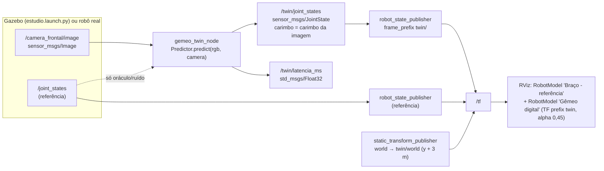

# Desenho do nó ROS 2 do gêmeo digital (imagem → `/twin/joint_states` → RViz)

O servidor web (`gemeo_digital/servidor`) é a vitrine do gêmeo; dentro do ecossistema ROS 2 o mesmo
`Predictor` roda como um nó, de modo que o gêmeo pode ser visualizado no RViz, gravado em rosbag e
comparado com o robô (simulado ou real) usando as ferramentas padrão.



## Interfaces

| Tópico | Tipo | QoS | Observação |
|---|---|---|---|
| `/camera_frontal/image` (parâmetro `camera_topic`) | `sensor_msgs/Image` (rgb8/bgr8) | best effort, fila 1 | mesma câmera do dataset (1280×720, hfov 60°) |
| `/joint_states` | `sensor_msgs/JointState` | reliable | só assinado por preditores oráculo (GT/ruído), para testes |
| `/twin/joint_states` | `sensor_msgs/JointState` | reliable | `joint_1..joint_6` em rad; carimbo herdado da imagem (permite casar com a referência no mesmo instante) |
| `/twin/latencia_ms` | `std_msgs/Float32` | reliable | tempo de inferência do preditor |
| `/twin/robot_description` | `std_msgs/String` | transient local | publicado pelo RSP do gêmeo (remapeado) |

Frames: a referência usa a árvore original (`world → base_link → … → base_garra`); o gêmeo usa a mesma
árvore com prefixo `twin/` e é ancorado por `world → twin/world` (deslocamento configurável `offset_y`;
use `0` para sobrepor o fantasma ao braço de referência).

## Arquivos

- `gemeo_twin_node.py` — o nó (parâmetros `camera_topic`, `camera`, `predictor` = `gt|ruido|pose|http|auto`, `pose_dir`).
- `twin.launch.py` — RSP do gêmeo + TF estático + nó + RViz opcional (`rviz:=true`, config `gemeo.rviz`).
- `publicar_dataset.py` — reproduz poses do split de teste do dataset em `/camera_frontal/image` e `/joint_states`.
- `testar_no_ros2.sh` / `verificar_tf_twin.py` — teste headless de ponta a ponta.

## Como usar

```bash
# no container cerise26_gemeo (ou qualquer ROS 2 Humble com o repositório):
ros2 launch servo6dof_camera estudio.launch.py headless:=true hd:=true      # referência (Gazebo)
ros2 launch gemeo_digital/ros2/twin.launch.py urdf:=modelo_digital/urdf/servo6dof.urdf \
     predictor:=pose camera_topic:=/camera_frontal/image rviz:=true
```

Sem Gazebo, o teste headless reproduz o dataset:
`bash scripts/rodar_container.sh ros2twin "bash gemeo_digital/ros2/testar_no_ros2.sh"`.

## Resultado do teste headless (26/10/2026, Spark)

Com o preditor oráculo, a distância entre `twin/base_garra` (descontado o deslocamento) e `base_garra`
no mesmo carimbo de tempo foi de 4,6e-16 m (5 amostras via tf2), o que confirma a cadeia
imagem → `/twin/joint_states` → TF. A taxa observada em `/twin/joint_states` foi de 1,0 a 1,3 Hz para
2 Hz publicados: imagens 1280×720 sem compressão com QoS best effort, num container limitado a 6 CPUs
e com o host em carga alta (load average entre 28 e 38), perdem quadros. Em produção, a recomendação é
usar `image_transport` comprimido ou reduzir a resolução na entrada do preditor.
